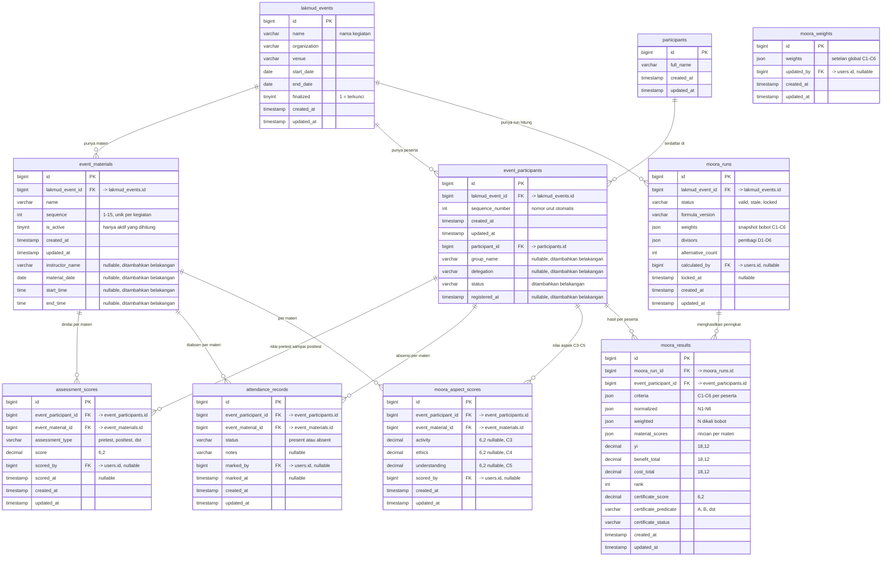
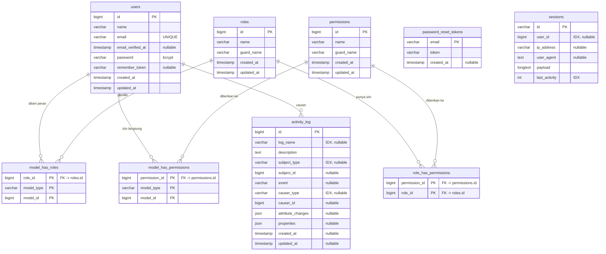
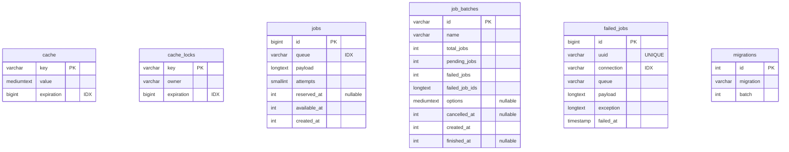

# Skema Database LAKMUD

Sumber: `information_schema` dari database `db_lakmud_penilaian` (MySQL 8.0.30), dibaca langsung dari server, bukan dari berkas migration. Total **25 tabel, 173 kolom**.

Diagram dibagi tiga: tabel domain penilaian, tabel akses & audit, dan tabel bawaan framework. Pemisahan ini hanya untuk keterbacaan; semuanya ada di satu database.

## 1. Tabel domain penilaian

`moora_weights` sengaja tidak punya relasi ke tabel lain: isinya satu baris setelan global untuk semua kegiatan, dan tidak ada foreign key yang menunjuk ke sana.

## 2. Tabel akses dan audit

`activity_log.causer_id` bukan foreign key fisik ke `users.id` (polimorfik lewat `causer_type`), jadi garisnya hanya penanda konseptual.

## 3. Tabel bawaan framework

Tidak dipakai untuk logika penilaian, tetapi ada di database yang sama.

## 4. Isi tabel saat ini

Angka baris dibaca bersamaan dengan skema, jadi ini kondisi database lokal saat dokumen dibuat.

| Tabel | Baris | Kolom |
|---|---:|---:|
| `lakmud_events` | 1 | 9 |
| `event_materials` | 15 | 11 |
| `participants` | 702 | 4 |
| `event_participants` | 702 | 10 |
| `attendance_records` | 10.530 | 9 |
| `assessment_scores` | 21.060 | 9 |
| `moora_aspect_scores` | 10.530 | 9 |
| `moora_runs` | 4 | 11 |
| `moora_results` | 2.808 | 16 |
| `moora_weights` | 0 | 5 |
| `users` | 2 | 8 |
| `roles` | 1 | 5 |
| `permissions` | 29 | 5 |
| `role_has_permissions` | 23 | 2 |
| `model_has_roles` | 7 | 3 |
| `model_has_permissions` | 0 | 3 |
| `activity_log` | 1.926 | 12 |
| `sessions` | 2 | 6 |
| `cache` | 3 | 3 |
| `cache_locks`, `jobs`, `job_batches`, `failed_jobs`, `password_reset_tokens` | 0 | 3-10 |
| `migrations` | 8 | 3 |

## 5. Catatan yang mudah salah dibaca

- **Tiga tabel menyimpan nilai penilaian, bukan satu.** `attendance_records` untuk absensi (C1), `assessment_scores` untuk pretest dan posttest (C2, C6), `moora_aspect_scores` untuk keaktifan, etika, dan pemahaman (C3, C4, C5). Ketiganya berpasangan unik pada (`event_participant_id`, `event_material_id`).
- **Bobot ada di dua tempat.** `moora_weights.weights` adalah setelan global yang bisa diubah operator di halaman Kriteria & Bobot. `moora_runs.weights` adalah salinan saat run dihitung, sehingga hasil lama tidak berubah ketika bobot global diganti.
- **`moora_results` menyimpan JSON, bukan kolom terpisah per kriteria.** `criteria`, `normalized`, `weighted`, dan `material_scores` berisi larik enam nilai C1-C6 sesuai urutan tetap.
- **`event_materials.sequence` dan `event_participants.sequence_number` sekarang diisi otomatis** oleh panel; kolomnya tetap ada karena dipakai untuk urutan tampil dan label M1-M15.
- **`lakmud_events.finalized` adalah kunci tingkat kegiatan.** Selama bernilai 1, semua penulisan data anak ditolak di `PanelService::mutate()`.
