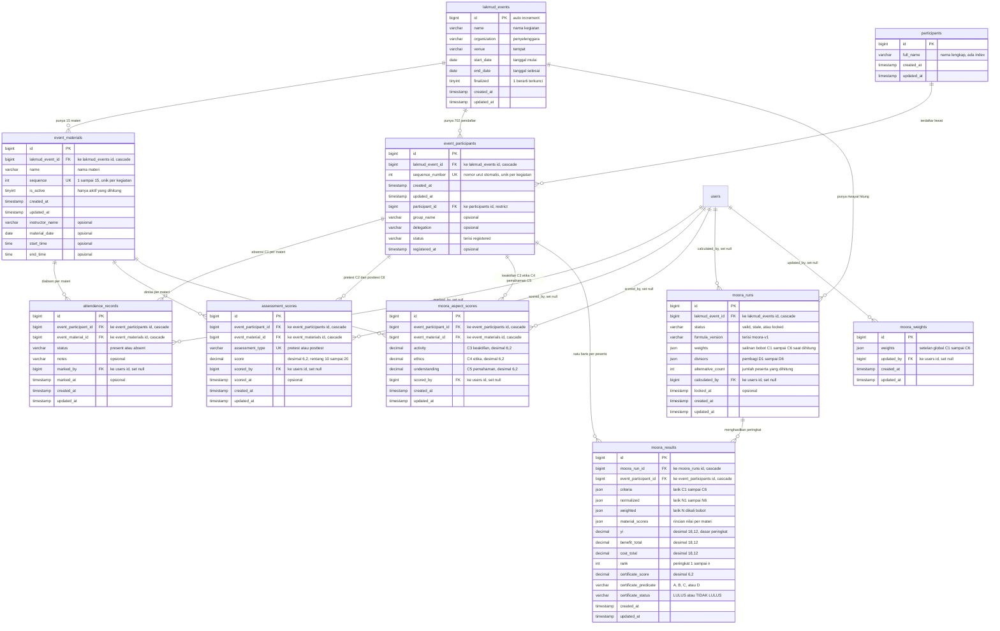
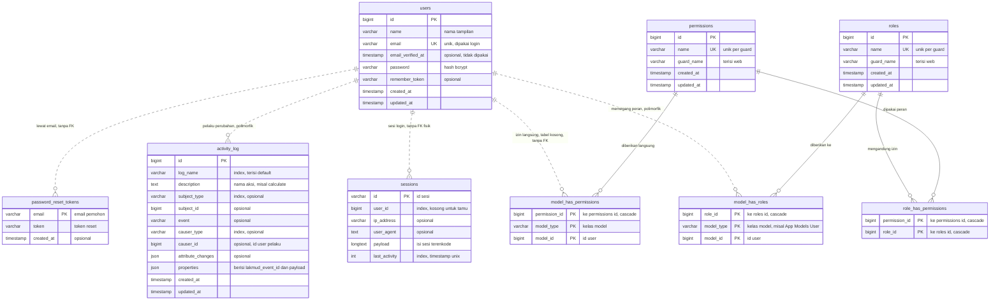
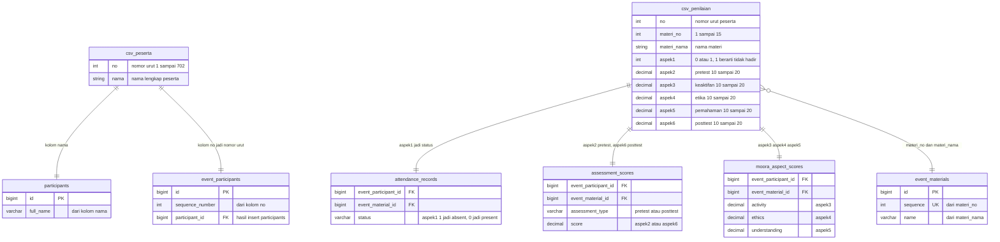

# ERD LAKMUD untuk Mermaid

Dokumen ini berisi blok `erDiagram` yang siap ditempel ke <https://mermaid.live>. Setiap blok berdiri sendiri: salin satu blok, tempel apa adanya, tidak perlu tambahan apa pun.

Sumber: `information_schema` database `db_lakmud_penilaian` (MySQL 8.0.30, InnoDB, utf8mb4_unicode_ci). Semua nama tabel dan kolom dibaca dari server, bukan dari berkas migration. Total 25 tabel, 173 kolom.

Isi dokumen:

1. ERD inti MOORA
2. ERD autentikasi dan otorisasi
3. ERD pipeline CSV (sumber data awal)
4. Peta fitur ke tabel
5. Catatan yang perlu diketahui

## 1. ERD inti MOORA

Sepuluh tabel inti plus `users` sebagai pemilik jejak pengisian. Yang disimpan di sini: kegiatan, peserta, nilai enam kriteria, bobot, dan hasil perangkingan.

`moora_weights` sengaja tidak punya relasi ke tabel mana pun selain `users`. Isinya satu baris setelan global untuk semua kegiatan, dan tidak ada foreign key yang menunjuk ke sana.

Garis `users` ke lima tabel nilai adalah jejak siapa yang mengisi atau menghitung, dengan aturan `ON DELETE SET NULL`. Menghapus user tidak menghapus data penilaian, hanya mengosongkan kolom pelakunya. Entitas `users` sendiri dirinci penuh di blok 2.

Kunci unik yang menjaga data tidak dobel:

| Tabel | Kunci unik |
|---|---|
| `event_materials` | (`lakmud_event_id`, `sequence`) dan (`id`, `lakmud_event_id`) |
| `event_participants` | (`lakmud_event_id`, `sequence_number`), (`lakmud_event_id`, `participant_id`), dan (`id`, `lakmud_event_id`) |
| `attendance_records` | (`event_participant_id`, `event_material_id`) |
| `assessment_scores` | (`event_participant_id`, `event_material_id`, `assessment_type`) |
| `moora_aspect_scores` | (`event_participant_id`, `event_material_id`) |
| `moora_results` | (`moora_run_id`, `event_participant_id`) |

## 2. ERD autentikasi dan otorisasi

Sembilan tabel. Enam tabel pertama adalah paket izin `spatie/laravel-permission`, tiga sisanya menangani sesi, token reset, dan jejak audit.

Tiga hal yang mudah salah dibaca di sini:

- **Garis putus-putus berarti relasi logis tanpa foreign key fisik.** `model_has_roles.model_id`, `model_has_permissions.model_id`, `sessions.user_id`, `activity_log.causer_id`, dan `password_reset_tokens.email` semuanya diisi aplikasi, bukan dijaga database. Hanya garis solid yang punya constraint nyata. Blok ini memuat 4 dari 21 foreign key: `model_has_roles.role_id` ke `roles`, `model_has_permissions.permission_id` ke `permissions`, dan dua di `role_has_permissions`.
- `activity_log.causer_id` **bukan** foreign key fisik. Relasinya polimorfik lewat `causer_type`, jadi tidak ada constraint ke `users.id` dan penghapusan user tidak menyentuh log.
- `model_has_roles` dan `model_has_permissions` memakai primary key gabungan tiga kolom (`role_id` atau `permission_id`, `model_type`, `model_id`). Kolom `model_type` yang membuatnya bisa dipakai model apa pun, bukan hanya `users`.

## 3. ERD pipeline CSV (sumber data awal)

Aplikasi **tidak punya fitur export CSV**. Yang ada adalah import satu arah: berkas Excel dikonversi ke dua CSV oleh `python_instruct/excel_to_seed_csv.py`, lalu `LakmudDataSeeder` memasukkannya ke database. Diagram ini memetakan kolom CSV ke kolom tabel tujuan.

Entitas `csv_peserta` dan `csv_penilaian` adalah **pseudo-entity**: keduanya bukan tabel di database, hanya bentuk berkas masukan. Tabel DB di blok ini sengaja hanya menampilkan kolom yang terlibat pipeline, bukan seluruh kolom. Skema lengkap tiap tabel ada di blok 1 dan blok 2.

Pemetaan kolom CSV ke kolom database, sesuai kode `LakmudDataSeeder::isiNilai()`:

| Kolom CSV | Tabel tujuan | Kolom tujuan | Aturan |
|---|---|---|---|
| `peserta.csv` `no` | `event_participants` | `sequence_number` | dipakai juga sebagai kunci upsert |
| `peserta.csv` `nama` | `participants` | `full_name` | di-trim |
| `penilaian.csv` `materi_no` | `event_materials` | `sequence` | wajib tepat 15 nilai unik |
| `penilaian.csv` `materi_nama` | `event_materials` | `name` | diambil dari baris pertama tiap materi |
| `penilaian.csv` `aspek1` | `attendance_records` | `status` | hanya boleh 0 atau 1, 1 menjadi `absent` |
| `penilaian.csv` `aspek2` | `assessment_scores` | `score` dengan `assessment_type` = `pretest` | 10 sampai 20, maksimal dua desimal |
| `penilaian.csv` `aspek3` | `moora_aspect_scores` | `activity` | 10 sampai 20, maksimal dua desimal |
| `penilaian.csv` `aspek4` | `moora_aspect_scores` | `ethics` | 10 sampai 20, maksimal dua desimal |
| `penilaian.csv` `aspek5` | `moora_aspect_scores` | `understanding` | 10 sampai 20, maksimal dua desimal |
| `penilaian.csv` `aspek6` | `assessment_scores` | `score` dengan `assessment_type` = `posttest` | 10 sampai 20, maksimal dua desimal |

`moora_runs` dan `moora_results` sengaja tidak diisi seeder. Keduanya hanya terisi lewat tombol Hitung MOORA, sehingga hasil perhitungan selalu berasal dari data yang benar-benar tersimpan.

## 4. Peta fitur ke tabel

Setiap halaman panel dan tabel yang dibacanya. Berguna saat menelusuri dari layar ke skema.

| Fitur atau halaman | Tabel utama | Tabel pendukung |
|---|---|---|
| Login dan logout | `users`, `sessions` | `activity_log` tidak dipakai di sini |
| Pemeriksaan izin setiap halaman | `permissions`, `roles`, `model_has_roles`, `role_has_permissions` | `model_has_permissions` (kosong) |
| Dashboard | `lakmud_events`, `event_participants`, `event_materials`, `moora_runs`, `moora_results` | tidak ada |
| Data kegiatan | `lakmud_events` | `activity_log` |
| Data materi | `event_materials` | `lakmud_events` untuk status kunci |
| Data peserta | `event_participants`, `participants` | `lakmud_events` |
| Absensi | `attendance_records` | `event_participants`, `event_materials` |
| Pretest dan posttest | `assessment_scores` | `event_participants`, `event_materials` |
| Keaktifan, etika, pemahaman | `moora_aspect_scores` | `event_participants`, `event_materials` |
| Perhitungan MOORA | `moora_runs`, `moora_results` | tiga tabel nilai di atas |
| Hasil perangkingan | `moora_results`, `moora_runs` | `event_participants`, `participants` |
| Finalisasi dan buka kunci | `moora_runs`, `lakmud_events` | `activity_log` |
| Kriteria dan bobot | `moora_weights` | `moora_runs` untuk status kunci |
| Jejak audit | `activity_log` | `users` lewat `causer_id` |
| Import data awal CSV | semua tabel inti kecuali `moora_runs` dan `moora_results` | tidak ada |

## 5. Catatan yang perlu diketahui

**Tidak ada fitur export CSV.** Pencarian di `app/`, `routes/`, `resources/views/`, `resources/js/`, `config/`, dan `composer.json` untuk kata `csv`, `export`, `download`, `streamDownload`, dan `fputcsv` tidak menemukan satu pun jalur ekspor. CSV hanya dipakai sebagai masukan. Kalau ekspor memang dibutuhkan, itu fitur baru, bukan dokumentasi dari yang sudah ada.

**Ada enam izin lama yang tersisa di database.** `permissions` berisi 29 baris, sedangkan `PanelPermissions::ALL` hanya mendefinisikan 23. Enam sisanya tidak dipakai kode mana pun: `assessments.aspects.view`, `assessments.aspects.input`, `data.manage`, `inputs.manage`, `panel.access`, `results.manage`. `role_has_permissions` berisi 23 baris, jadi peran operator hanya memegang izin yang aktif. Sisa ini tidak mengganggu, tetapi sebaiknya dibersihkan sebelum sidang agar tidak menimbulkan pertanyaan saat skema diperiksa.

**`password_reset_tokens` ada tetapi tidak dipakai.** Tabel ini bawaan Laravel, dan `routes/web.php` tidak punya rute lupa kata sandi maupun reset. Belum ada fitur reset mandiri. Akun tanpa kata sandi harus direset lewat `artisan tinker`.

**`moora_weights` boleh kosong.** Saat tabel ini kosong, `MooraWeights::current()` memakai bobot bawaan `0.10 / 0.10 / 0.20 / 0.15 / 0.20 / 0.25` dari `MooraCalculator::WEIGHTS`. Jadi kosong bukan berarti rusak.

**Bobot tersimpan dua kali dengan tujuan berbeda.** `moora_weights.weights` adalah setelan global yang bisa diubah operator. `moora_runs.weights` adalah salinan saat run dihitung, sehingga hasil lama tidak berubah ketika bobot global diganti. Saat membandingkan hasil antar run, yang menentukan adalah kolom di `moora_runs`, bukan yang di `moora_weights`.

**Nilai enam kriteria tidak ada di satu tabel.** C1 di `attendance_records`, C2 dan C6 di `assessment_scores` dengan pembeda `assessment_type`, C3 sampai C5 di `moora_aspect_scores`. Setelah perhitungan, keenam nilai itu disalin menjadi larik JSON di `moora_results.criteria` sesuai urutan tetap C1 sampai C6.

**Tidak ada view dan tidak ada trigger.** Seluruh logika ada di lapisan aplikasi (`PanelService`, `MooraCalculator`, `MooraWeights`, `CertificateScoreCalculator`), bukan di database.

**Kunci kegiatan ada di `lakmud_events.finalized`.** Selama bernilai 1, `PanelService::mutate()` menolak semua penulisan data anak dan mengembalikan pesan kesalahan, walaupun kolomnya sendiri tidak punya constraint.
